# Occavie

> **Make every moment count.**

Occavie is a full-stack event platform. People discover events and book tickets, organizers plan and run events, and administrators oversee the whole site. It is a Spring Boot + Thymeleaf + MongoDB application with three role-based workspaces (Admin, Organizer, Participant) and a set of rule-based "smart" features (search, recommendations, comparison, an organizer Copilot and a visitor Concierge) that need **no AI service, no API keys and no extra configuration**.

Developed by **Md. Zubayer Ahmad Shibly**.

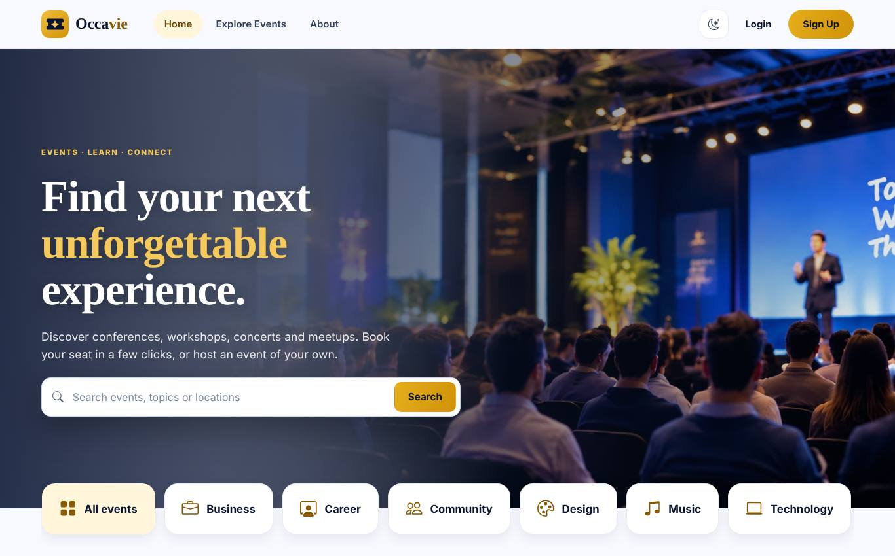

## Screenshots

| Smart search | Compare events | Concierge assistant |
|---|---|---|
| 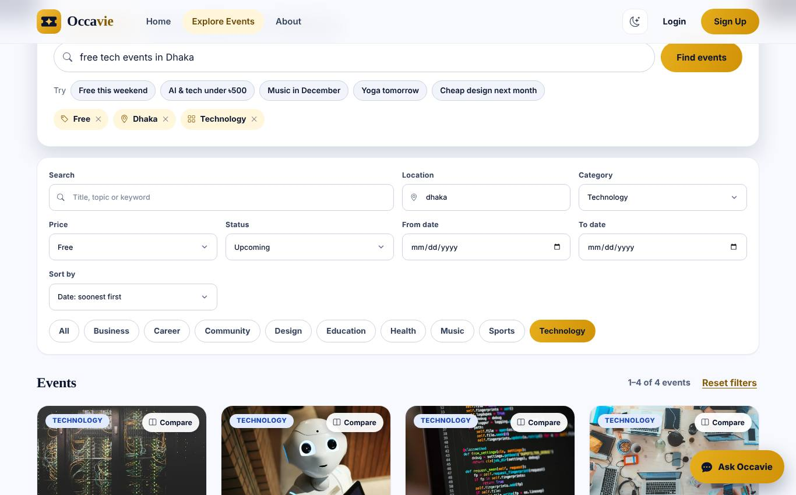 | 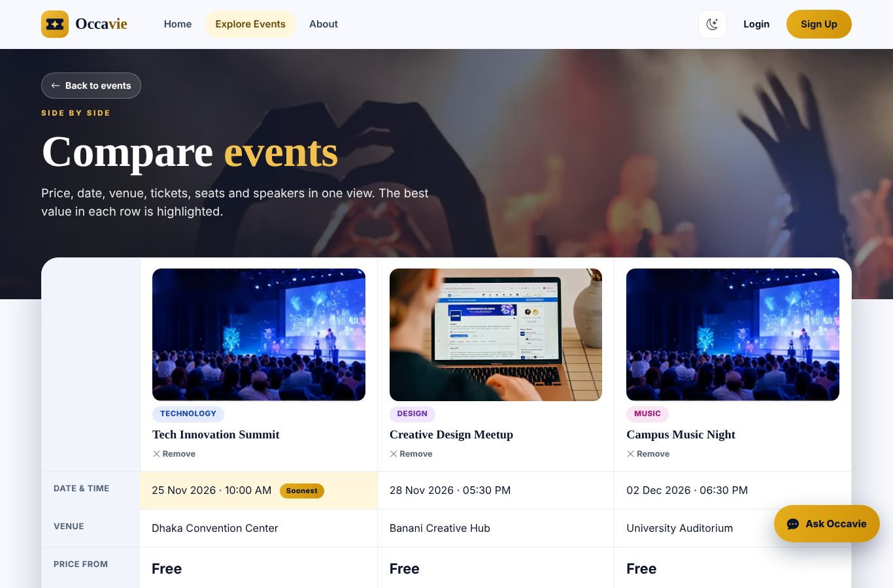 | 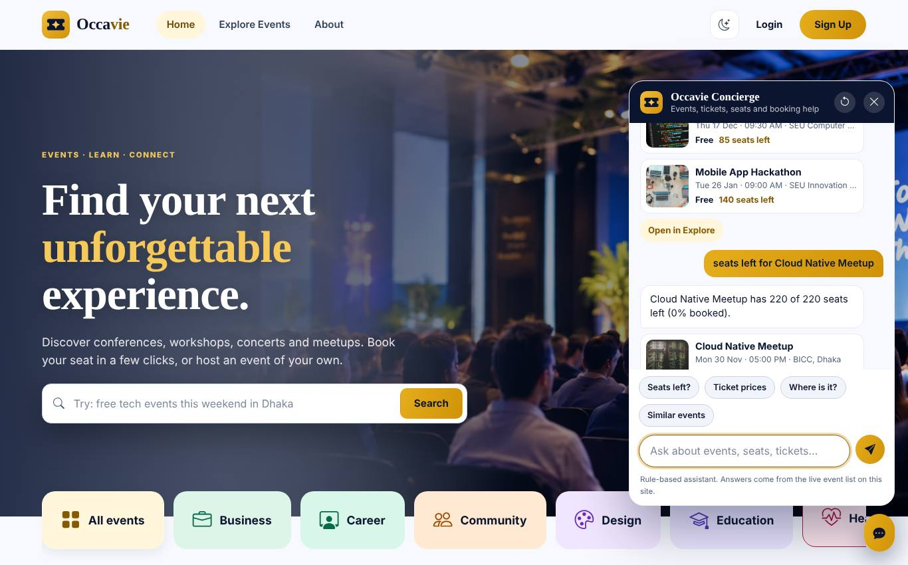 |

| Recommendations with reasons | Organizer Copilot | Sign in |
|---|---|---|
| 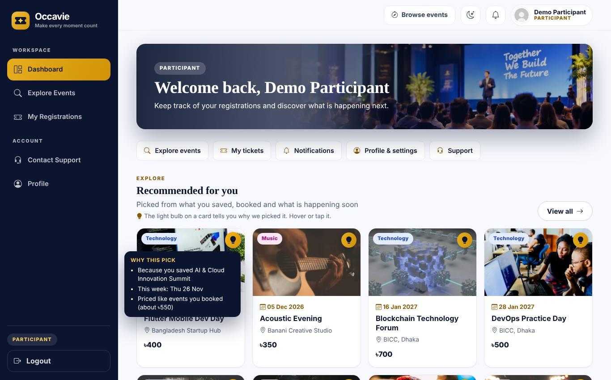 | 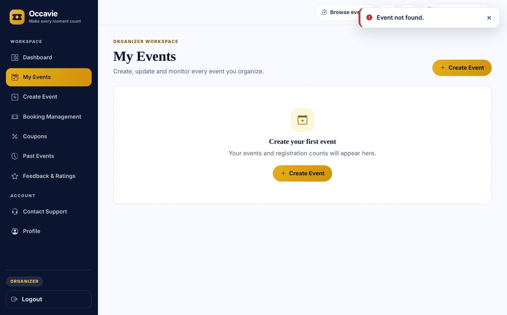 | 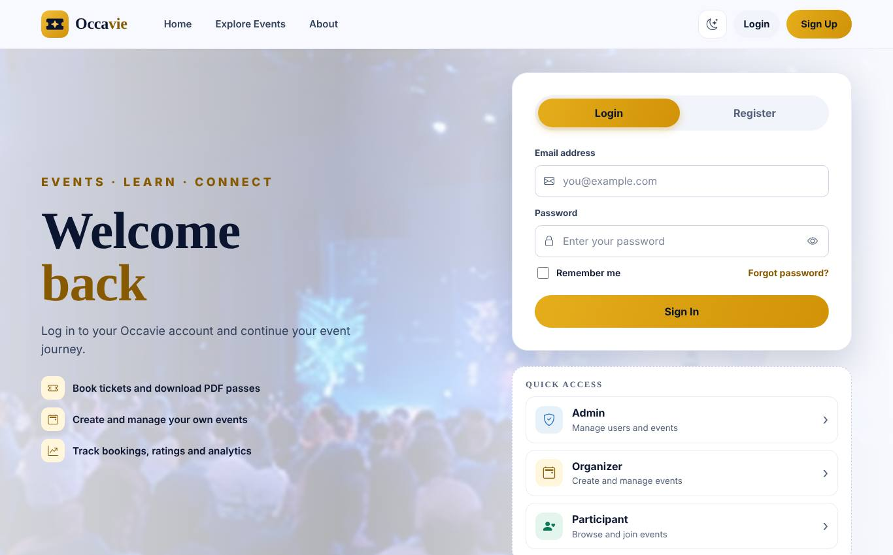 |

| Explore | Event details | Admin (dark mode) |
|---|---|---|
|  |  | 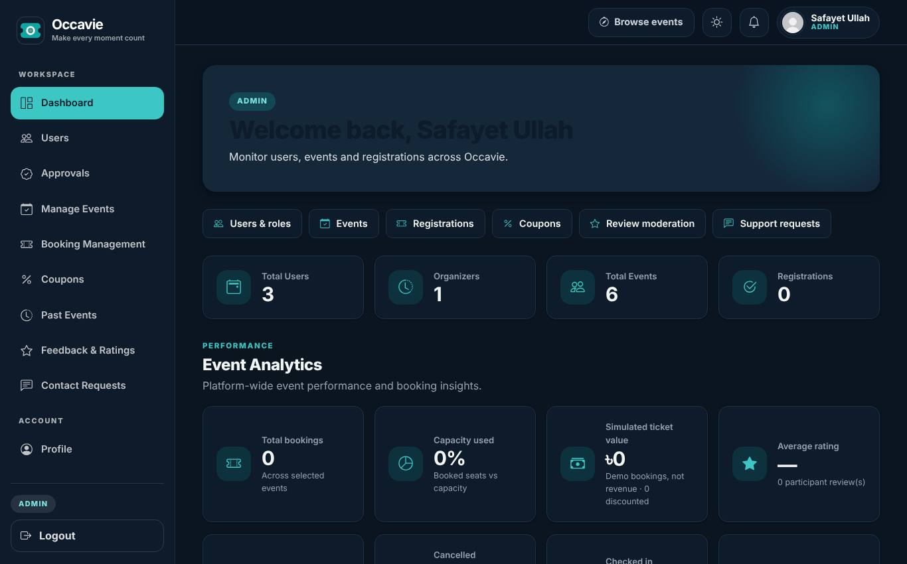 |

| Register | Forgot password |
|---|---|
| 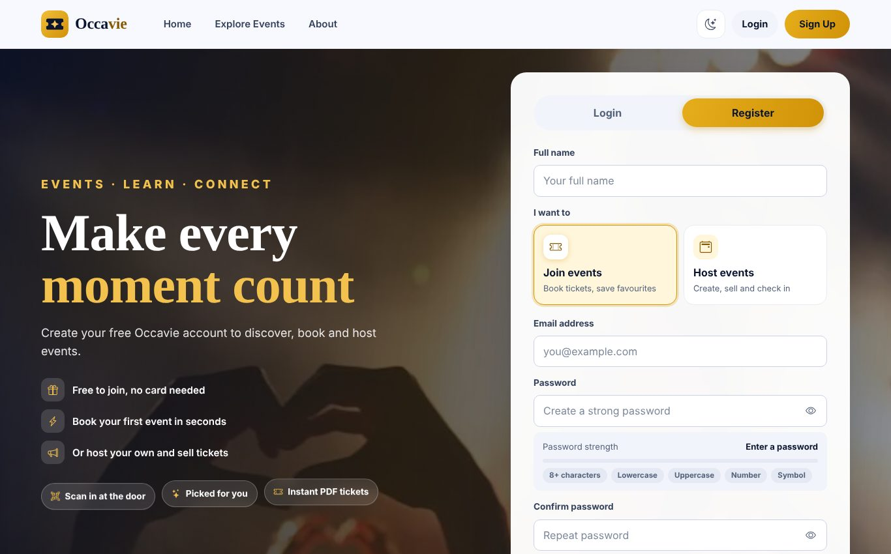 | 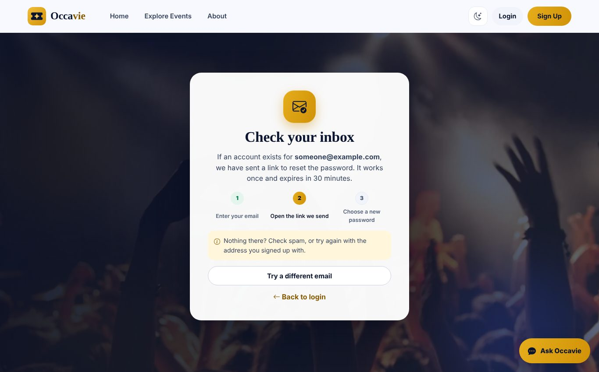 |

| Mobile | Mobile, dark mode |
|---|---|
| 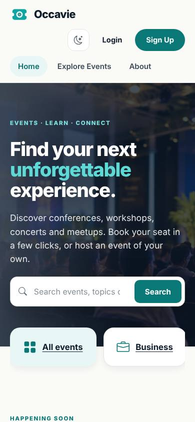 | 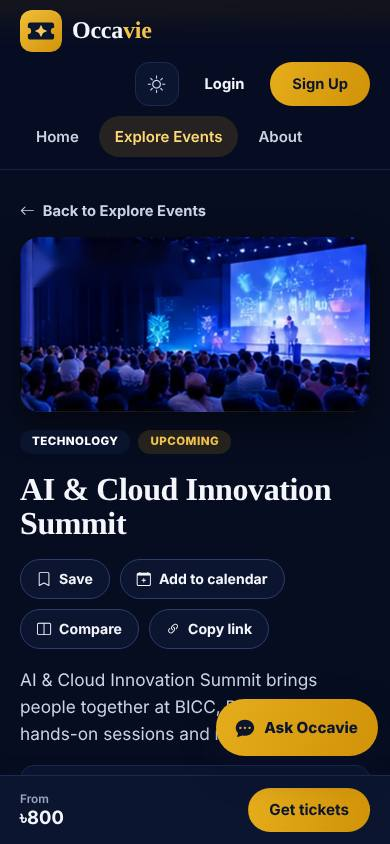 |

> Screenshots come from a local run with sample data.

## What the website can do

In one list:

* **Find events**: search in plain sentences, filter by topic, price, date and place, sort, and save favourites.
* **Get answers**: ask the on-site Concierge about seats, prices, venues and tickets.
* **Get ideas**: personal recommendations with a 💡 reason on every card.
* **Compare**: put 2 or 3 events side by side.
* **Book**: free or paid tickets, coupons, waitlist, instant PDF tickets and receipts with QR codes.
* **Attend**: add to calendar, share, get reminders and announcements, rate events afterwards.
* **Organize**: create events with a guided wizard, schedules, speakers, sponsors, galleries, ticket types and coupons, and get a Copilot readiness score with next steps.
* **Run the door**: scan QR tickets or enter codes for fast, single-use check-in.
* **Measure**: analytics, attendance rates and CSV exports.
* **Administer**: manage users, events, approvals, reviews and support messages.
* **Everywhere**: phone, tablet and desktop layouts, light and dark mode, accessible and secure by default.

The details follow.

### Smart features (rule-based, offline, no configuration)

| Feature | What visitors get | Where |
|---|---|---|
| **Smart search** | Type a sentence such as *"free AI workshops in Dhaka this weekend"*. It fills in category, price, price cap, dates and place, shows what it understood as removable chips, and relaxes filters step by step (saying so) if nothing matches. The Bangladesh weekend (Friday and Saturday) is used. | Home search bar, Explore page |
| **Occavie Concierge** | A floating "Ask Occavie" assistant. Ask *"seats left for Cloud Native Meetup"*, *"how much is the AI summit"*, *"compare yoga and cricket"*, *"how do I get my ticket?"*. Answers come from the live event list with clickable event cards and follow-up chips. On an event page it understands *"where is it?"*. | Every public page |
| **Recommendations with reasons** | "Recommended for you" ranks upcoming events from what a participant saved and booked (topic, venue area, price level), timing and demand. Each card has a 💡 icon; hover or tap it to see why ("Because you saved X", "Free, like the events you picked", "Only 6 seats left"). | Participant dashboard, "You might also like" on event pages |
| **Compare events** | Press *Compare* on 2 or 3 events and open a side-by-side table: date, venue, price, ticket types, seats left, speakers, programme, rating, organizer, with the best value highlighted. | Event cards, event pages, `/compare` |
| **Organizer Copilot** | A 0-100 readiness score per event (title, description, cover photo, date and venue, schedule, speakers, tickets, capacity, gallery, sponsors), a ranked "do this next" list with Fix links to the exact screen, and growth tips for published events (low bookings, no coupon, nearly full). It only advises, it never changes anything. | My Events, organizer dashboard, event wizard review step, `/organizer/events/{id}/copilot` |

How they stay honest: recommendations never suggest booked, saved, sold-out, past or cancelled events; no topic takes more than half a list; the Concierge says it is rule-based, never invents events, and asks "which event do you mean?" when unsure.

### Booking and tickets

* Free and ticket-category booking, coupons, capacity enforcement, waitlist with held-seat offers, cancellation of free bookings.
* PDF tickets and receipts with **signed QR codes**; organizer check-in by camera or manual code with atomic, single-use scanning.
* **Simulated payments**: a demo checkout with bKash, Nagad and Visa look-alikes. No real money moves, and demo amounts are never presented as revenue. By default any coupon code gives a flat 10% demo discount (`OCCAVIE_COUPON_ACCEPT_ANY=false` restores strict mode).

### Organizer tools

* Event wizard with private drafts, preview, duplicate, cancel and reschedule notices; optional admin approval workflow.
* Programme, speakers, sponsors, photo gallery, ticket types, coupons, announcements, participant lists, feedback and ratings, waitlist management.
* Analytics: bookings, capacity use, cancellations, check-ins and attendance rate, ticket mix, registration trend, ratings.
* **CSV exports** (participants, bookings, check-in, attendance), organizer-only and protected against spreadsheet formula injection.

### Admin tools

* Users and roles, event and registration oversight, event approvals, review moderation, support inbox, platform analytics.

### Visitors and participants

* Discovery with search, filters, sorting and pagination; saved events; "add to calendar" (.ics); share links with Open Graph previews; organizer public pages; venue details with map link.
* Notifications with preferences; MongoDB-backed email outbox (Resend over HTTPS) with retries and de-duplication; reminder job.
* Accounts with remember-me and token-based password reset by email.

### Look and feel

* Navy-and-gold identity with serif headings, an original logo, photo-led pages, light and dark themes.
* Responsive layouts (checked at phone, tablet, laptop and large-desktop widths), skip links, keyboard-friendly dialogs, custom 404 and error pages, optional installable PWA shell that only caches static assets.

### Platform

* `/healthz` and `/readyz`, `robots.txt`, dynamic `sitemap.xml`, JSON-LD event data, content-hashed static assets (a deploy can never be shadowed by a stale cached stylesheet).

## Upgrade log

| Area | What changed |
|---|---|
| Identity and design | Complete visual identity, new design system, navy-and-gold theme with serif headings, new logo and icons, photo hero, per-topic coloured category tiles |
| Booking | Event pages, checkout, PDF tickets and receipts, demo-payment labelling, coupons |
| Dashboards | Participant, organizer and admin dashboards with photo event cards and analytics |
| Check-in | Signed QR tickets, camera/manual check-in, duplicate-scan protection |
| Event management | Creation wizard, drafts, waitlist with held-seat offers, cancellation and reschedule flows, approval workflow |
| Communication | In-app notifications, email outbox, announcements, reminders |
| Reporting | Extended analytics, organizer-only CSV exports, cancelled-registration counter |
| Security | Rate limiting, token-based password reset, upload content checks, CSP and security headers, production secret validation, bootstrap admin, demo accounts disabled in production |
| SEO and platform | Custom error pages, sitemap, robots, health endpoints, JSON-LD, PWA shell, content-hashed assets |
| Accessibility | WCAG A/AA checks (axe) across roles, four viewport sizes and light/dark themes; fixes for contrast, labels and keyboard focus |
| Deployment | Dockerfile, Render blueprint, deployment guide, production profile |
| Imagery | Real topic-matched photos for every sample event, one distinct image each |
| Demo data | Sample events on an empty database; a daily job keeps at least 24 upcoming events inside the next 90 days with shuffled dates |
| Performance | Event page queries run in parallel; Save updates instantly without reloading |
| Fixes | "Invalid payment reference" after paying (the reference prefix check), stale cached CSS, wrong contact details |
| Smart features | Smart search, Compare events, Recommendations with reasons (💡), Organizer Copilot, Occavie Concierge |

## Stack

Java 26 (JDK 21 also builds with `-Djava.version=21`), Spring Boot 4.1.1, Spring MVC, Spring Security, Thymeleaf, Spring Data MongoDB, Caffeine cache, Maven wrapper, Lombok, ZXing (QR), vanilla JavaScript and CSS (Source Serif 4 and Inter, Bootstrap Icons, Chart.js).

## Architecture

```text
Browser (Thymeleaf pages + small JS modules: smart-search, concierge, compare, explore)
   ↓
Controllers  → security: roles, CSRF, rate limits, headers/CSP
   ↓
Services     → booking and capacity rules, waitlist, check-in, notifications, email outbox,
               analytics, exports, RecommendationEngine, ReadinessEngine, sample-event maintainer
   ↓
Repositories → MongoDB (events, registrations, users, tickets, outbox, notifications, images…)
```

* Capacity and waitlist changes run inside MongoDB transactions guarded by a per-event version counter.
* Background work (email outbox, reminders, offer expiry, sample-event upkeep) runs in-process and can also be triggered by an external scheduler (`POST /internal/jobs/run` with `X-Jobs-Token`).
* The recommendation and Copilot logic live in pure classes (`RecommendationEngine`, `ReadinessEngine`); search and the Concierge are pure browser scripts (`smart-search.js`, `concierge-core.js`). All are unit-tested without a database.

## Run locally

Requirements: JDK 21 or newer and a MongoDB (Atlas free tier or local).

```bash
cp .env.example .env            # then edit; or export the variables directly
export MONGODB_URI="mongodb://localhost:27017/eventflow"
./mvnw spring-boot:run          # add -Djava.version=21 if you only have JDK 21
```

Open http://localhost:8080. Without the `prod` profile the app seeds three **demo accounts** (local development only):

| Role | Email | Password |
|---|---|---|
| Admin | `admin@eventflow.com` | `Admin123!` |
| Organizer | `organizer@eventflow.com` | `Organizer123!` |
| Participant | `participant@eventflow.com` | `Participant123!` |

These credentials are public. In production they are disabled automatically once a real administrator exists.

For a fuller demo, set `OCCAVIE_SAMPLE_EVENTS=true` (see below) or run the scripts in `scripts/` from mongosh or the Compass shell.

## Configuration

Everything is configured with environment variables; none is needed for the smart features. See [`.env.example`](.env.example).

| Variable | Purpose |
|---|---|
| `MONGODB_URI`, `MONGODB_DATABASE` | MongoDB connection (the URI is required) |
| `SPRING_PROFILES_ACTIVE=prod` | Production profile: secure cookies, no demo accounts, startup safety checks |
| `OCCAVIE_PUBLIC_URL` | Public https address (emails, sitemap, social previews) |
| `OCCAVIE_REMEMBER_KEY`, `OCCAVIE_TICKET_SECRET` | Two different random secrets of 24+ characters (required in production) |
| `OCCAVIE_BOOTSTRAP_ADMIN_EMAIL`, `OCCAVIE_BOOTSTRAP_ADMIN_PASSWORD` | Creates the first real admin on first start; remove the password afterwards |
| `OCCAVIE_SAMPLE_EVENTS` | `true` fills an **empty** database with about 54 sample events and keeps at least 24 upcoming |
| `OCCAVIE_COUPON_ACCEPT_ANY` | Demo coupons (default `true`); `false` = only real coupons |
| `OCCAVIE_APPROVAL_REQUIRED` | `true` = new events need admin approval |
| `OCCAVIE_EMAIL_PROVIDER`, `RESEND_API_KEY`, `OCCAVIE_EMAIL_FROM` | Optional email (also needed for password-reset emails) |
| `OCCAVIE_JOBS_TOKEN`, `OCCAVIE_JOBS_POLL_MS`, `OCCAVIE_REMINDER_HOURS` | Background jobs |
| `OCCAVIE_EVENT_TIMEZONE` | Default `Asia/Dhaka` |
| `OCCAVIE_CONTACT_EMAIL`, `OCCAVIE_CONTACT_WHATSAPP`, `OCCAVIE_CONTACT_ADDRESS`, `OCCAVIE_DEVELOPER_NAME`, `OCCAVIE_DEVELOPER_URL`, `OCCAVIE_DEVELOPER_FACEBOOK`, `OCCAVIE_DEVELOPER_LINKEDIN` | What the footer and Contact page show |
| `PORT`, `THYMELEAF_CACHE` | Host-provided port, template cache |

Production (`prod`) **refuses to start** with a missing, weak or shared secret, or a non-https public URL.

## Demo data and images

* `OCCAVIE_SAMPLE_EVENTS=true` loads sample events with tickets and schedules **only when the database has no events**. They belong to a non-login "Occavie Events" account. At start-up and daily at 03:10 the app keeps at least 24 of them inside the next 90 days with shuffled dates and at most 2 per day: unbooked expired events get a new date, booked ones stay as history and a fresh copy is scheduled. Real organizers' events are never touched. Set it to `false` once you have your own events.
* `scripts/eventflow-demo-40-no-registrations.js` and `scripts/occavie-more-events.js` are optional mongosh seed scripts.
* Photos: sample-event images are from [Unsplash](https://unsplash.com) (Unsplash License) plus a few supplied project photos, one distinct image per event (`static/images/event-photos/`, `static/images/photos/`). Events created without a photo get a topic photo or generated cover.

## Tests

```bash
./mvnw test -Djava.version=21 -Dtest='!EventflowApplicationTests'     # Java unit tests (no database needed)
node --test src/test/js/*.test.js                                      # search parser and Concierge tests
```

The Java tests (133 at the time of writing) cover booking and capacity, coupons, free and simulated-paid booking, payment references, cancellation, waitlist, QR check-in, approval workflow, notifications and email, announcements, recommendations, the Copilot rules, CSV export safety, security helpers (rate limiter, production secret checks, upload checks) and sample-event scheduling. The Node tests (32) cover Smart Search and the Concierge. `EventflowApplicationTests` loads the whole application and needs a reachable MongoDB (`MONGODB_URI`).

Accessibility and layout were also checked with axe (WCAG 2 A/AA) and an overflow check across the roles, four viewport sizes and both themes; see the upgrade log.

## Deployment

See [DEPLOYMENT.md](DEPLOYMENT.md). Render (Docker) is the recommended host; Vercel is explained and not recommended for this architecture. A `Dockerfile` and `render.yaml` are included. Notes for Render: use an always-on instance for a public demo (free instances sleep), keep it to a single instance (sessions live in memory), allow the host in MongoDB Atlas Network Access and put Atlas and the service in the same region.

## Security notes

* Role-based route protection (`/admin/**`, `/organizer/**`, `/participant/**`), ownership checks on every organizer action, CSRF on all state-changing requests.
* BCrypt password hashes; password-reset tokens are random, stored hashed, single-use and expire in 30 minutes; the reset form never reveals whether an email exists.
* Rate limits on login (per IP and per email), registration, password reset, contact form, coupon preview, booking and check-in (in-memory, so per instance).
* Uploads accept only JPEG, PNG or WEBP up to 2 MB, verified by file signature.
* Tickets use signed codes (HMAC) and atomic check-in to stop double use. Participant data is only visible to the event's own organizer. CSV exports are organizer-only and neutralise spreadsheet formulas.
* CSP, `X-Content-Type-Options`, `Referrer-Policy`, `Permissions-Policy`, frame protection; `Secure`, `HttpOnly`, `SameSite=Lax` session cookies in production.
* No default secrets in production; demo accounts and demo password reset are disabled by the `prod` profile.
* Privacy: the Concierge and Compare keep their state in the browser only; the Concierge's single request reads public event data. No third-party AI or tracking service is used.

## Known limitations

* Payments are simulated by design; amounts are demo values, not revenue.
* Sessions and rate limits are per instance, so run one instance (multi-instance would need shared sessions).
* The CSP still allows inline scripts (`'unsafe-inline'`).
* The smart features are rule-based: they understand the patterns described above, not free-form English, and they say so when they do not understand.
* "Weekend" means Friday and Saturday (Bangladesh).
* The service worker caches static assets only; there is no offline booking.
* Waitlist, booking and payment transactions are unit-tested with mocks; they were not exercised against a transaction-capable MongoDB in the automated tests, and the Docker image build was not run in the build environment.
* Admin-level CSV export of participant data is deliberately not provided.

## Credits

Developer: Md. Zubayer Ahmad Shibly. Photos: Unsplash contributors (Unsplash License). Icons: Bootstrap Icons. Charts: Chart.js. QR codes: ZXing.

## Technical notes

For compatibility the Java package is `com.eventflow`, the MongoDB database and collection names keep their original names, and the three demo accounts use `@eventflow.com` addresses. These are internal names only; the site everywhere else is Occavie.
