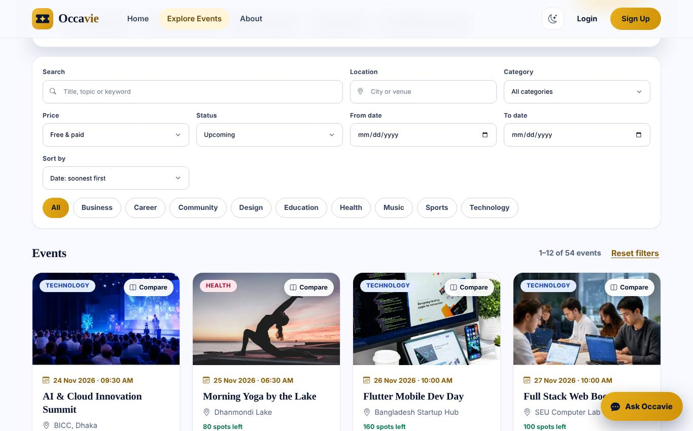
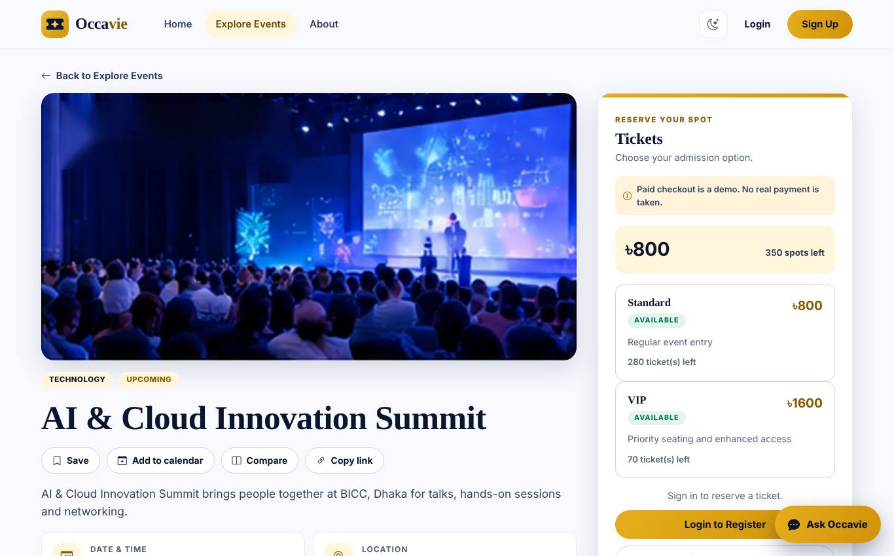
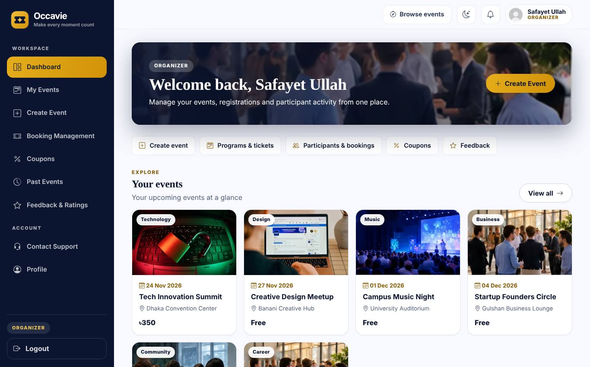

# Occavie

> **Make every moment count.**

Occavie (formerly EventFlow) is a full-stack event management platform: people discover events and book tickets, organizers build and run events, and admins oversee the platform. It is a Spring Boot + Thymeleaf + MongoDB monolith with three role-based workspaces.


| Discover | Event details | Organizer workspace |
|---|---|---|
|  |  |  |

| Admin (dark mode) | Mobile | Mobile, dark |
|---|---|---|
|  |  |  |

> Screenshots come from a local run with seeded demo data.

## Features

**Implemented**

* **Smart search:** type a sentence such as "free AI workshops in Dhaka this weekend" (home page or Explore) and it sets category, price, price cap, dates (Bangladesh weekend = Fri + Sat) and place automatically, shows what it understood as removable chips, and relaxes filters step by step (saying so) if nothing matches. Rule-based and offline: no AI service, no keys.
* **Occavie Concierge:** a floating assistant on every public page. Visitors ask in plain words ("free tech events this weekend", "seats left for Cloud Native Meetup", "compare yoga and cricket", "how do I get my ticket?") and get answers from the live event list with clickable event cards and follow-up chips: finding and recommending events, seats and ticket prices, when/where, similar and compared events, plus how booking, tickets, payments, cancellation, the waitlist and accounts work. On an event page it also understands "this event" and "where is it?". Rule-based and offline (no AI service, no keys); its only request is a read-only, cached public `GET /concierge/data.json`. It says so itself and never invents events.
* **Organizer Copilot:** every event gets a 0-100 readiness score (title, description, cover photo, date and venue, schedule, speakers, tickets, capacity, gallery/sponsors) with a ranked "do this next" list and a Fix link to the exact screen. It shows on My Events, the organizer dashboard ("Events that need attention"), the last step of the event wizard and a full Copilot page; published events also get growth tips (low bookings, no coupon, nearly full). Rule-based and offline; it never changes anything by itself.
* **Recommendations with reasons:** the participant dashboard and each event page rank upcoming events from what the person saved and booked (category, venue area, price level), timing and demand, and show why in plain words ("Because you saved Flutter Mobile Dev Day", "Free, like the events you picked", "Only 6 seats left"). Booked, saved, sold-out, past and cancelled events are never suggested, and no category takes more than half the list. Rule-based and offline; new visitors get "happening soon / popular" reasons.
* **Compare events:** press Compare on 2-3 event cards (or on an event page), then open a side-by-side table of date, venue, price, ticket types, seats left, speakers, programme, rating and organizer, with the best value highlighted. The selection is kept in the browser only.
* **Discovery:** search, category/price/date/status filters, sorting, pagination, saved events, event suggestions, organizer public pages.
* **Event pages:** programme, speakers, sponsors, gallery, venue details and map link, share/copy link, Open Graph previews, "add to calendar" (.ics).
* **Booking:** free and ticket-category booking, coupons, capacity enforcement, waitlist with held-seat offers, cancellation of free bookings, PDF tickets with signed QR codes.
* **Demo coupons:** by default any entered coupon code is accepted for a flat 10% demo discount (real coupons keep their own rules). Set `OCCAVIE_COUPON_ACCEPT_ANY=false` for strict mode.
* **Simulated payments:** a demo checkout (bKash/Nagad/card look-alikes). **No real money moves, and demo amounts are never presented as revenue.**
* **QR check-in:** organizer check-in page (camera or manual code), signed single-use tickets, duplicate-scan detection.
* **Organizer tools:** event wizard with drafts, preview, duplicate, cancel/reschedule notices, announcements, coupons, participant lists, feedback, CSV exports (participants, bookings, check-in, attendance), analytics (bookings, capacity use, cancellations, check-ins and attendance %, ticket mix, trend, ratings).
* **Admin tools:** user/role management, event and registration oversight, optional event-approval workflow, platform analytics, contact-request inbox.
* **Notifications:** in-app notifications with preferences; MongoDB-backed email outbox (Resend over HTTPS) with retries and de-duplication; reminder job.
* **Accounts:** registration, login, remember-me, token-based password reset by email (one-time, hashed, 30 min).
* **UI:** original Occavie identity, light/dark themes, responsive layouts, skip links, keyboard-friendly modals, custom 404/403 pages, optional installable PWA shell (static assets only).
* **Platform:** `/healthz` and `/readyz`, `robots.txt`, dynamic `sitemap.xml`, JSON-LD event data.

**Not implemented / planned**

* Real payment gateway (payments are simulated by design).
* Shared HTTP sessions for multi-instance scaling (sessions are in memory; run one instance).
* Real offline use. The service worker only caches static assets; booking needs a connection.
* Admin-level CSV export of participant data (deliberately organizer-only).
* Historical cancellation counts before the cancellation counter was introduced.

## Stack

Java 26 (JDK 21 also builds with `-Djava.version=21`), Spring Boot 4.1.1, Spring MVC, Spring Security, Thymeleaf, Spring Data MongoDB, Caffeine cache, Maven wrapper, Lombok, ZXing (QR), vanilla JS + CSS (Manrope/Inter, Bootstrap Icons, Chart.js).

## Architecture

```text
Browser (Thymeleaf pages + small JS modules)
   ↓
Controllers  → security: roles, CSRF, rate limits, headers/CSP
   ↓
Services     → booking/capacity rules, waitlist, check-in, notifications, email outbox, analytics, exports
   ↓
Repositories → MongoDB (events, registrations, users, tickets, outbox, notifications, images…)
```

Capacity and waitlist changes run inside MongoDB transactions guarded by a per-event version counter. Background work (email outbox, reminders, offer expiry) runs in-process and can also be triggered by an external scheduler (`POST /internal/jobs/run`).

## Run locally

Requirements: JDK 21+ and a MongoDB (Atlas free tier or local).

```bash
cp .env.example .env            # then edit; or export the variables directly
export MONGODB_URI="mongodb://localhost:27017/eventflow"
./mvnw spring-boot:run          # add -Djava.version=21 if you only have JDK 21
```

Open http://localhost:8080. Without the `prod` profile the app seeds three **demo accounts** (local development only):

| Role | Email | Password |
|---|---|---|
| Admin | `admin@eventflow.com` | `Admin123!` |
| Organizer | `organizer@eventflow.com` | `Organizer123!` |
| Participant | `participant@eventflow.com` | `Participant123!` |

These credentials are public. In production they are disabled automatically once a real administrator exists (see below).

## Configuration

See [`.env.example`](.env.example) for every variable. Production (`SPRING_PROFILES_ACTIVE=prod`) requires `MONGODB_URI`, `OCCAVIE_PUBLIC_URL` (https), `OCCAVIE_REMEMBER_KEY` and `OCCAVIE_TICKET_SECRET` (24+ random characters each, different from each other) and **will not start** otherwise.

## Demo data

`scripts/eventflow-demo-40-no-registrations.js` seeds 40 events (it resets its own earlier seed). `scripts/occavie-more-events.js` adds 30 more upcoming events without touching anything else (run either in mongosh or the Compass shell). Events without an uploaded photo automatically get an original category cover (`/images/covers/`, three variants per category).

### Sample events on a fresh database

Set `OCCAVIE_SAMPLE_EVENTS=true` and the app loads about 54 upcoming sample events (with tickets and schedules) **only if the database has no events at all**. They belong to a non-login "Occavie Events" organizer. Set `OCCAVIE_CONTACT_EMAIL`, `OCCAVIE_CONTACT_WHATSAPP` and `OCCAVIE_DEVELOPER_NAME` to control what the footer and Contact page show; no personal contact details are stored in the repository.

Sample events never run out: at start-up and daily at 03:10 the app keeps at least 24 sample events inside the next 90 days, with shuffled dates and at most 2 per day. Expired events nobody booked get a new date; booked ones stay as history and a fresh copy is scheduled. Only the non-login "Occavie Events" account's events are touched; real organizers' events never change. Set `OCCAVIE_SAMPLE_EVENTS=false` once you have your own events.

### Image credits

Sample-event photos are from [Unsplash](https://unsplash.com) (Unsplash License) plus a few supplied project photos. The 54 sample events each use a different image (`static/images/events/`, `static/images/photos/`).

## Tests

```bash
./mvnw test -Djava.version=21 -Dtest='!EventflowApplicationTests'
```

Java unit tests (see `src/test`) plus 12 Node tests for the search parser (`node --test src/test/js/`) (Mockito, no database needed) cover booking/capacity, coupons, free and simulated-paid booking, cancellation, waitlist, QR check-in, approval workflow, notifications/email, announcements, UX features, security helpers (rate limiter, production secret checks, upload sniffing, CSV injection, JSON-LD escaping). `EventflowApplicationTests` loads the full context and therefore needs a reachable MongoDB (`MONGODB_URI`).

## Deployment

See [DEPLOYMENT.md](DEPLOYMENT.md): Render (Docker) is the recommended host; Vercel is explained and not recommended for this architecture. A `Dockerfile` and `render.yaml` are included.

## Security notes

* Role-based route protection (`/admin/**`, `/organizer/**`, `/participant/**`), ownership checks on every organizer action, CSRF on all state-changing requests.
* BCrypt password hashes; password-reset tokens are random, stored hashed, single-use and expire in 30 minutes; the reset form never reveals whether an email exists.
* Rate limits on login (per IP and per email), registration, password reset, contact form, coupon preview, booking and check-in. In-memory, so per instance.
* Uploads accept only JPEG/PNG/WEBP, ≤ 2 MB, verified by file signature, not just by declared type.
* Tickets use signed codes (HMAC) and atomic check-in to stop double use. Participant data is only visible to the event's own organizer.
* CSP, `X-Content-Type-Options`, `Referrer-Policy`, `Permissions-Policy`, frame protection; `Secure`/`HttpOnly`/`SameSite=Lax` session cookies in production.
* No default secrets in production; demo accounts and demo password reset are disabled by the `prod` profile.
* Known limits: CSP still allows inline scripts (`'unsafe-inline'`); sessions and rate limits are per instance.

## Known limitations

* Payments are simulated. Amounts shown are demo values, not revenue.
* Deployment instructions are written and the production profile was tested locally, but the app has **not** been deployed or verified on Render/Vercel from this repository, and the Docker image build was not run (no Docker daemon in the build environment).
* Waitlist and booking transactions are unit-tested with mocks; they have not been exercised against a transaction-capable MongoDB in this release.

## Project history

Rebranded from EventFlow. The Java package (`com.eventflow`), the MongoDB database and collection names, URLs, and the three demo email addresses are unchanged for compatibility.
